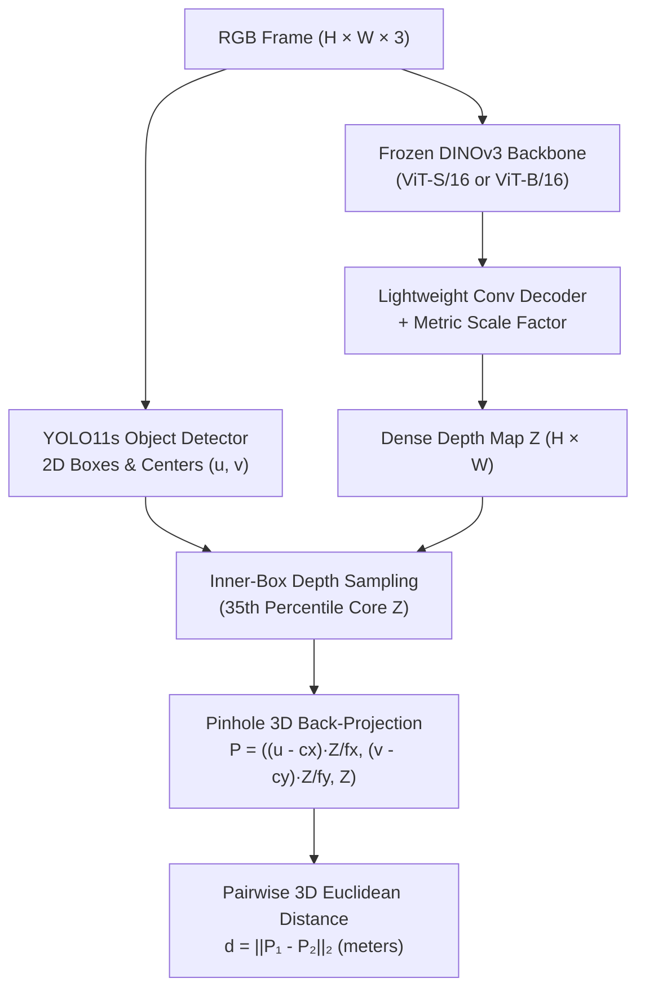
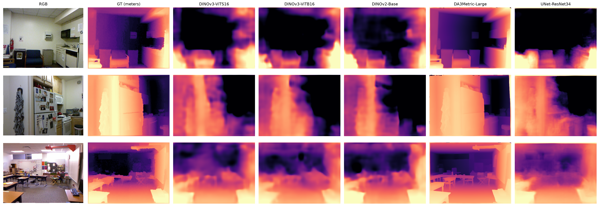
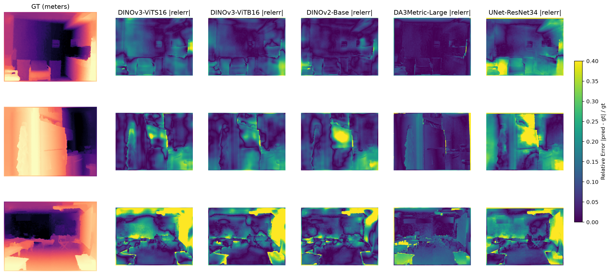
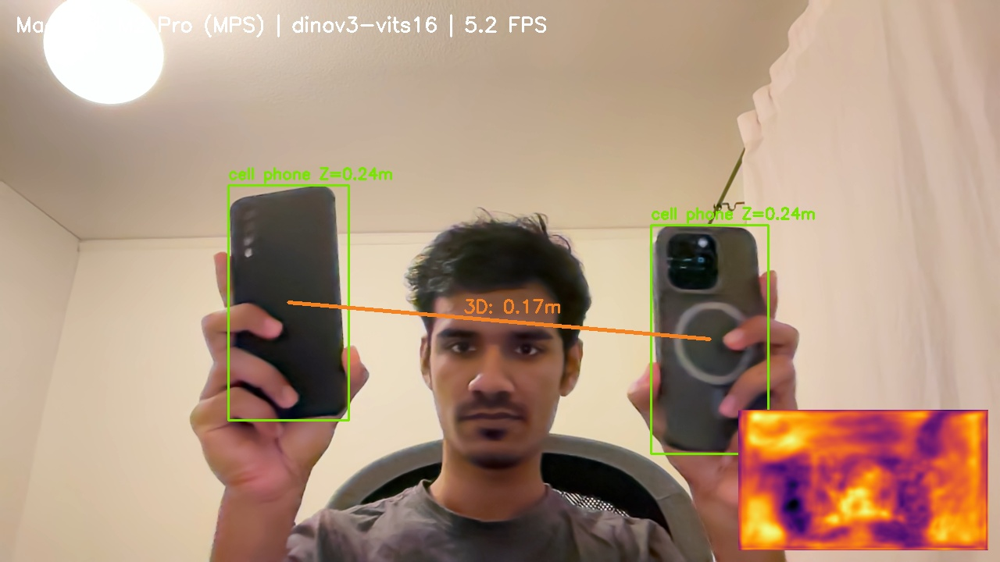
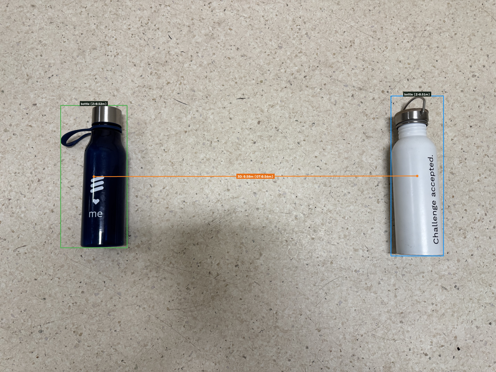
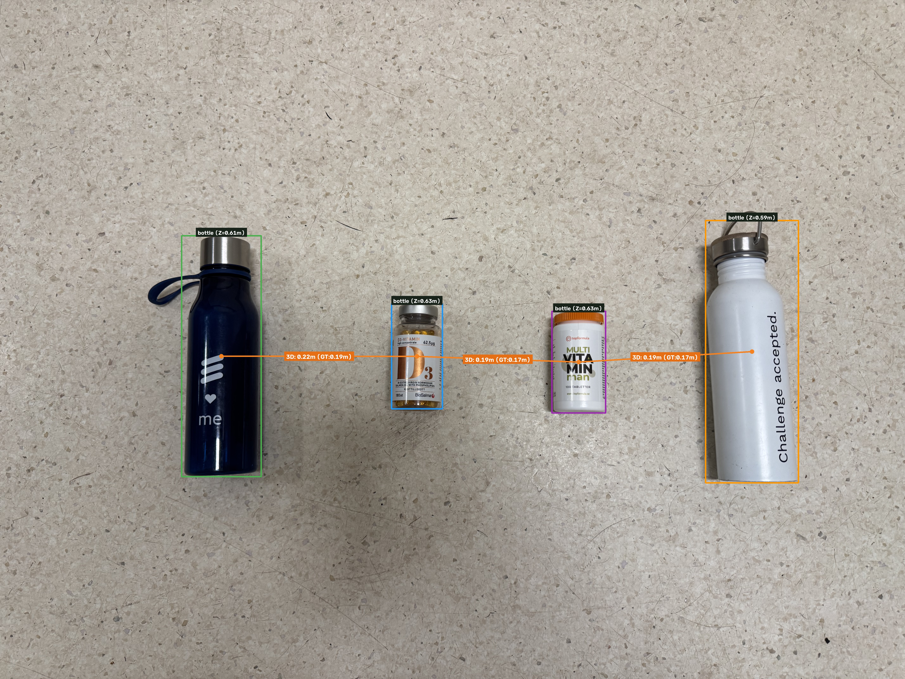
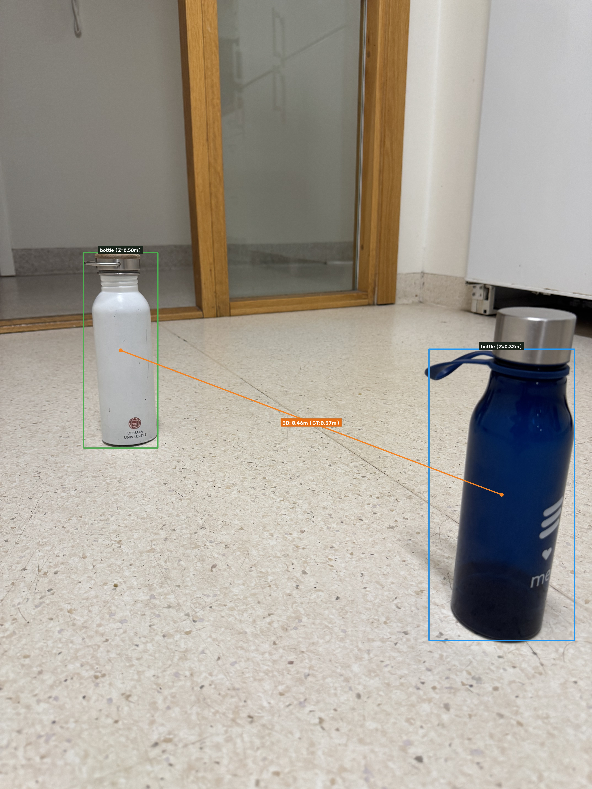

# HT2026 Group D - DINOv3

This repository is a comparative study of applications of DINOv3, including:

- drone tracking and distance estimation
- real-time 3D object distance estimation from a single RGB camera
- loop closure and long-term place recognition
- medical image applications

This README documents the **Real-Time 3D Object Distance Estimation** part.

## Real-Time 3D Object Distance Estimation from a Single RGB Camera

The implementation estimates scene depth from one RGB image or video frame, back-projects detected object centers into 3D camera coordinates, and calculates the distance between objects.

**Pipeline Architecture:**



The project:

1. benchmarks depth estimation on NYU Depth v2;
2. trains a lightweight depth head on a frozen DINOv3 backbone;
3. compares DINOv3 against DINOv2, Depth Anything 3, and a ResNet-34 U-Net;
4. evaluates measured 3D distances against tape-measure ground truth;
5. runs object detection and 3D distance estimation on still images and live camera input.

## Repository Structure

```text
distance-estimation/
├── dinov3_depth_distance_v1.ipynb  # Main training, benchmark, and evaluation notebook
├── live.ipynb                      # macOS/iPhone live demo
├── stream_iphone.py                # MJPEG camera server for remote/SSH streaming
├── nyu_results.csv                # NYU benchmark results
├── weights/
│   ├── head_dinov3-vits16.pt      # Trained small depth head
│   ├── head_dinov3-vitb16.pt      # Trained base depth head
│   └── yolo11s.pt                 # YOLO 11 object detector
└── outputs/
    ├── demo_thumb.jpg              # Live iPhone/webcam demo frame
    ├── nyu_qualitative.png         # RGB, ground truth, and model depth maps
    ├── nyu_errors.png              # Relative-error visualizations
    ├── nyu_rel_error.png           # Additional relative-error comparison
    ├── pred_2797.jpg               # Bottle distance example
    ├── pred_2801.jpg               # Multi-bottle distance example
    └── pred_2810.jpg               # Bottle distance example
```

## Method

### Depth estimation

A frozen DINOv3 vision transformer is used as the feature backbone. Intermediate spatial feature maps are fused with a lightweight convolutional decoder and upsampled to full image resolution.

The available checkpoints are:

- `dinov3-vits16`: ViT-Small backbone
- `dinov3-vitb16`: ViT-Base backbone

The backbone weights remain frozen during depth-head training.

### Object detection

Ultralytics YOLO 11 (`yolo11s.pt`) detects objects in RGB frames. The 3D distance is calculated from the center of each detected object:

```text
X = (u - cx) * Z / fx
Y = (v - cy) * Z / fy
P = (X, Y, Z)
```

Here, `(u, v)` is the object-center pixel location and `Z` is the sampled depth. The 3D distance between two objects is:

```text
distance = ||P1 - P2||₂
```

## Results

### NYU Depth v2 benchmark

The main notebook evaluates the standard NYU Depth v2 validation/test set of 654 images. The depth-head models are trained using 2,000 streamed training samples and frozen backbones.

The metrics are:

- **AbsRel**: mean absolute relative error
- **RMSE**: root mean squared error in meters
- **δ1**: percentage of pixels satisfying `max(pred/gt, gt/pred) < 1.25`
- **ms/image**: depth-inference time

Median alignment rescales relative-depth predictions to the median of the ground truth. The `none` variant reports unaligned predictions. Raw unaligned values should not be interpreted as guaranteed metric depth.

| Model | AbsRel ↓ | RMSE ↓ | δ1 ↑ | ms/image |
|---|---:|---:|---:|---:|
| DINOv3-ViTB16 + head | 0.1207 | 0.4502 | 0.8596 | 4.6907 |
| DINOv2-Base + head | 0.1109 | 0.4169 | 0.8795 | 4.4291 |
| DA3Metric-Large | 0.0766 | 0.3707 | 0.9259 | 11.4863 |
| DA3-Small | 0.1182 | 0.5236 | 0.8587 | 11.1920 |
| DINOv3-ViTS16 + head | 0.1422 | 0.5186 | 0.8107 | 9.8236 |
| DINOv2-Small + head | 0.1273 | 0.4656 | 0.8448 | 7.6465 |
| UNet-ResNet34 | 0.2117 | 0.7608 | 0.6774 | 4.2129 |

The complete benchmark, including unaligned measurements, is available in [`nyu_results.csv`](nyu_results.csv).

#### Qualitative NYU comparison



#### Relative-error comparison



### Real object-distance evaluation

Still-image measurements used a 0.50 m ground-truth distance between two bottle objects. The result from the DINOv3-ViTB16 head was:

- **mean absolute error:** 12.67 cm
- **mean relative error:** 40.8%

The Depth Anything 3 metric-large baseline was more accurate in this set:

- **mean absolute error:** 4.03 cm
- **mean relative error:** 13.0%

The live notebook also demonstrated DINOv3 distances on real camera scenes and used a 15-second live preview to save a demonstration frame.

### Live demo



The live demo detects objects, displays each object's estimated depth, and draws a 3D distance line between detected objects. A full-depth map is also shown as an overlay.

### Still-image outputs







> Reported values depend on camera focal length, depth scaling, image resolution, object-center sampling, and the quality of the YOLO detections. Median alignment and scale factors are therefore used for comparison and must be calibrated for a new camera.

## Setup

The notebooks were developed in Jupyter with Python and CUDA in one environment and Apple Silicon MPS in the live notebook.

Install the core dependencies:

```bash
pip install torch torchvision torchaudio
pip install timm ultralytics opencv-python numpy pandas pillow matplotlib tqdm datasets huggingface_hub flask
```

Additional packages may be required while running the optional Depth Anything 3 or training sections.

For DINOv3, Hugging Face access can be gated. Log in and accept the relevant model terms:

```bash
huggingface-cli login
```

The notebook sets cache and project paths for the original Uppmax environment. Update these values before running outside that environment:

```python
HF_HOME = "/your/local/huggingface-cache"
TORCH_HOME = "/your/local/torch-cache"
```

## Running the Main Notebook

From the repository root:

```bash
cd distance-estimation
jupyter lab
```

Open [`dinov3_depth_distance_v1.ipynb`](dinov3_depth_distance_v1.ipynb) and run the cells in order.

Important notebook inputs:

- update absolute image/video paths;
- run the NYU loading and training cells;
- use the supplied checkpoint files from `weights/`;
- provide your own room images or video for the measurement section;
- calibrate `F_PX` and `CALIB_W` for the target camera.

The live cell expects a local YOLO weight and DINOv3 head. For the notebook:

```text
weights/yolo11s.pt
weights/head_dinov3-vits16.pt
weights/head_dinov3-vitb16.pt
```

Keep the notebook's working directory at `distance-estimation/`, and update the weight-loading lines to use the `weights/` folder:

```python
yolo = YOLO("weights/yolo11s.pt")
CKPT_PATH = f"weights/head_{MODEL_KEY}.pt"
```

For the live notebook, update the corresponding YOLO and checkpoint loads similarly:

```python
yolo = YOLO("weights/yolo11s.pt")
depth_model.load_state_dict(
    torch.load(f"weights/head_{MODEL_KEY}.pt", map_location=device, weights_only=True),
    strict=False,
)
```

## Running the Live macOS Demo

Open [`live.ipynb`](distance-estimation/live.ipynb) and run it from `distance-estimation/`.

The notebook:

- uses Apple Metal (`MPS`) when available;
- tries iPhone Continuity Camera at camera index 1;
- falls back to the Mac webcam at camera index 0;
- sets `dinov3-vits16` and scale factor `0.3729` by default;
- saves a preview as `demo_thumb.jpg` after the configured live-preview duration.

To switch to the larger checkpoint:

```python
MODEL_KEY = "dinov3-vitb16"
SCALE_FACTOR = 0.3695
```

MacOS may need Camera permission for the Terminal or VS Code process. The iPhone must be connected and Continuity Camera must be enabled.

## Streaming an iPhone Camera with Flask

[`stream_iphone.py`](stream_iphone.py) exposes a macOS camera through a local MJPEG server. Run it from `distance-estimation/`:

```bash
python stream_iphone.py
```

Open either endpoint:

```text
http://127.0.0.1:8080/video
http://127.0.0.1:8080/frame.jpg
```

`/video` continuously streams MJPEG frames. `/frame.jpg` returns one JPEG frame per request.

The script probes camera indices `0` through `3` using macOS AVFoundation and prints the index and resolution it selects.
